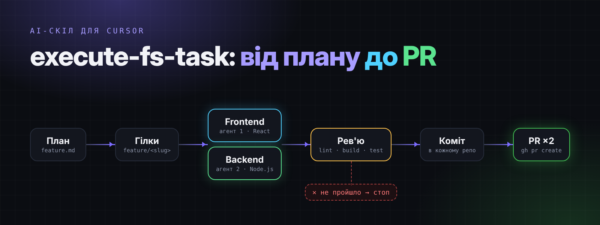

<p align="center"></p>

# execute-fs-task

Скіл для Cursor, який бере план full-stack фічі й доводить її до pull request'ів: створює гілки, запускає двох агентів паралельно — на фронті й бекенді, — робить рев'ю і відкриває PR. **Тільки якщо рев'ю пройшло.**

## Що робить скіл

1. **План** — читає MD-план фічі й ділить задачі на клієнт і сервер.
2. **Гілки** — створює `feature/<slug>` від вашої базової гілки в кожному репо.
3. **Два агенти** — фронт і бек пишуться паралельно, кожен агент працює тільки у своєму репо.
4. **Рев'ю** — окремий агент звіряє код із планом і запускає `lint`, `build`, `test`.
5. **Стоп** — якщо рев'ю не пройшло, скіл показує, чого не вистачає, і нічого не комітить.
6. **Коміт** — по одному в кожному репо, за правилами з `git-practice.mdc`.
7. **PR** — пушить гілки й відкриває pull request'и через `gh`.

## Що потрібно

- **Cursor** з підтримкою скілів і сабагентів.
- **Набір скілів [superpowers](https://github.com/obra/superpowers)**: потрібен скіл `executing-plans`. Плани зручно писати скілом `writing-plans` з того ж набору.
- **Структура проєкту**: батьківський git-репо, всередині — два окремі git-репо, фронт і бек.
- **GitHub CLI** (`gh`), авторизований через `gh auth login`.
- Скрипти `lint`, `build`, `test` у `package.json` обох репо. Без них рев'ю вважається непройденим.

```text
my-project/                          ← батьківський git-репо
├── .cursor/
│   ├── rules/
│   │   └── git-practice.mdc         ← рул по гіту
│   └── skills/
│       └── execute-fs-task/
│           └── SKILL.md             ← сам скіл
├── docs/superpowers/plans/
│   └── 2026-11-24-overview.md       ← план фічі
├── my-app-client/                   ← git-репо фронтенду
└── my-app-server/                   ← git-репо бекенду
```

## Встановлення

### 1. Скопіюйте файли

Скопіюйте папку [`.cursor`](.cursor) з цього репо в корінь свого батьківського репо. Або завантажте файли окремо:

- [`.cursor/skills/execute-fs-task/SKILL.md`](.cursor/skills/execute-fs-task/SKILL.md)
- [`.cursor/rules/git-practice.mdc`](.cursor/rules/git-practice.mdc)

### 2. Замініть змінні

Знайдіть у обох файлах усі `{{…}}` і підставте свої значення. Найшвидше — пошуком із заміною в Cursor (`Ctrl/Cmd + Shift + H`).

| Змінна | Що означає | Приклад |
|---|---|---|
| `{{IMPLEMENTER_MODEL}}` | Модель для двох агентів-виконавців. Беріть швидку й дешеву — план уже покроковий | `composer-2.5-fast` |
| `{{REVIEWER_MODEL}}` | Модель для рев'ю. Беріть сильнішу: пропущений критерій коштує дорожче | `composer-2.5` |
| `{{BASE_BRANCH}}` | Гілка, від якої створюються фічі і куди відкриваються PR (є і в SKILL.md, і в git-practice.mdc) | `main`, `develop` |
| `{{CLIENT_REPO}}` | Назва папки з git-репо фронтенду | `my-app-client` |
| `{{SERVER_REPO}}` | Назва папки з git-репо бекенду | `my-app-server` |
| `{{PKG}}` | Пакетний менеджер для install / lint / build / test | `pnpm`, `yarn` |
| `{{PROTECTED_FILES}}` | Спільні файли, які агенти не чіпають без вказівки в плані | `app.module.ts, the router` |
| `{{EXCLUDED_PLANS}}` | Плани, які скіл ніколи не виконує (індекси, оглядові). Якщо таких немає — `none` | `2026-11-09-index.md` |

> **npm:** для скриптів потрібен `npm run` (`npm run lint`). Замініть `{{PKG}} install` на `npm install`, а решту `{{PKG}}` — на `npm run`.

### 3. Перевірте, що Cursor бачить скіл

Наберіть у чаті агента `/` — у списку має з'явитися `execute-fs-task`. Якщо його немає, перезапустіть Cursor.

### 4. Напишіть план фічі

Покладіть план у `docs/superpowers/plans/` з датою в назві, наприклад `2026-11-24-overview.md`. Назва без дати стане назвою гілки: `feature/overview`.

Як має виглядати план — дивіться [`examples/2026-11-24-overview.md`](examples/2026-11-24-overview.md).

### 5. Запустіть

```text
/execute-fs-task docs/superpowers/plans/2026-11-24-overview.md
```

Або просто назвою фічі: `/execute-fs-task overview`.

### 6. Заберіть результат

- **Рев'ю пройшло** — скіл позначить чекбокси в плані, зробить коміти й поверне посилання на PR у кожному репо.
- **Рев'ю не пройшло** — скіл покаже, чого не вистачає (Missing / Refactor / Add) і які команди впали, і нічого не закомітить. Допрацюйте код або план і запустіть ще раз.

## Поради

- **Якість результату = якість плану.** Агенти виконують план буквально: чим чіткіші шляхи до файлів, контракт API і критерії приймання, тим рідше падає рев'ю.
- **Пропишіть контракт API в плані явно**: ендпоінт, поля, типи. Агенти не бачать роботу одне одного, тож план — єдине місце, де вони «домовляються».
- **Не мерджте наосліп.** Скіл відкриває PR, але фінальне рев'ю — ваше.
- **Перед запуском** переконайтеся, що в усіх трьох репо немає незакомічених змін — інакше скіл зупиниться ще на кроці створення гілок.
- Скіл ніколи не робить force-push і не амендить коміти, а `git push` і `gh` за замовчуванням ідуть через підтвердження.

## PDF-версія

Та сама інструкція у PDF: [`docs/guide.pdf`](docs/guide.pdf).

---

Автор — Нікіта. Більше про розробку з AI — в Instagram: [@YOUR_HANDLE](https://instagram.com/YOUR_HANDLE)

Ліцензія: [MIT](LICENSE)
